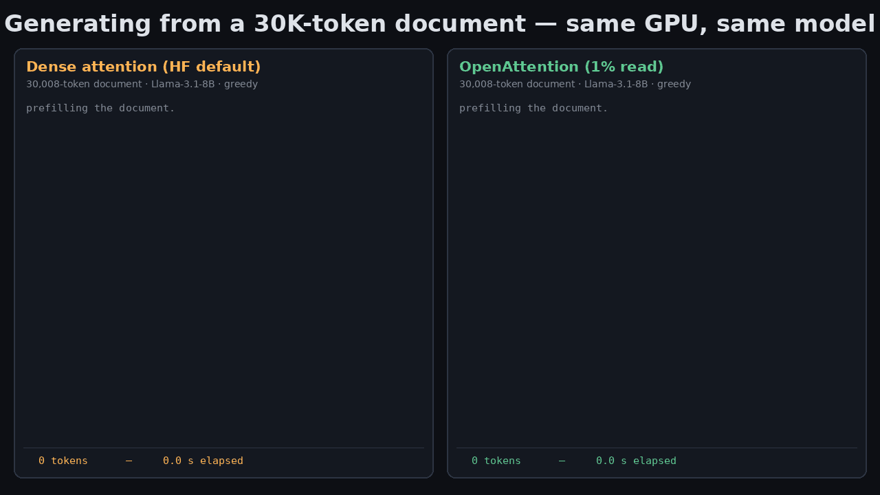
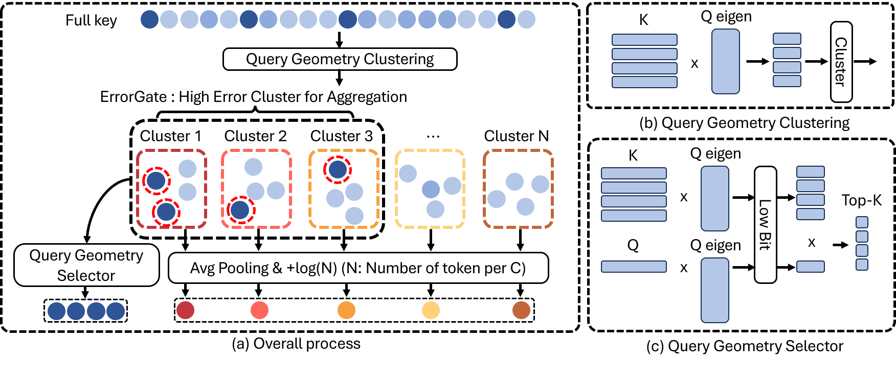

# OpenAttention: One Percent Is Enough with Tail Proxies

[**Project page**](https://hyunwoo137.github.io/OpenAttention/) · **Paper: arXiv coming soon** (under double-blind review)

<p align="center">
  
</p>
<p align="center"><sub>
Same GPU, same Llama-3.1-8B, same 30K-token document, batch 1. Left: Hugging Face dense attention
(default SDPA backend). Right: OpenAttention reading 1% of the KV cache.
Reproduce it with <a href="#demo">demo/</a>.
</sub></p>

**TL;DR** — Sparse attention usually *discards* or *samples* the unread tail of the KV cache; both
fail at low reads. OpenAttention folds every unread token into a few count-aware cluster proxies and
spends the exact-read budget where the estimated error is largest. At a **1% read** it keeps **99% of
dense accuracy** on RULER-32K HARD (86.30 vs 87.04), where the best prior method gets 48.2, and its
fused decode kernel runs the attention stage **10× faster** than dense at batch 32. The deployed
CUDA-graph decode path generates **4.6× faster** than the stock Hugging Face dense path end to end
(52.2 → 11.4 ms/token at batch 1 on one H100).

## Highlights

RULER-32K HARD (7 tasks × 200 requests), Llama-3.1-8B-Instruct, matched **total** per-query reads
(the proxy stream is charged too). Dense attention scores **87.04**.

| Total read | MagicPIG | HashAttention | vAttention | **OpenAttention** |
|---|---|---|---|---|
| 10% | 52.52 | 81.23 | 83.08 | **87.08** |
| 5%  | 34.42 | 71.55 | 68.86 | **86.82** |
| 3%  | 24.01 | 63.48 | 55.74 | **86.83** |
| 1%  | 10.53 | 48.22 | 36.29 | **86.30** |

<p align="center">
  
</p>

**How it works.** Offline-free and training-free, per request:
1. **QGC** (query-geometry clustering) partitions the keys once per prefill, in a rank-16 projection
   that respects the directions the queries actually use.
2. **QGS** (query-geometry selector) scans rank-32 int8 key codes every step and picks the top-k.
3. **ErrorGate** estimates each cluster's weight error from its cached mean/variance statistics and
   water-fills the exact-read budget across clusters — instead of ranking clusters by centroid score.
4. Every token still unread is folded into its cluster's **count-aware mean proxy**
   (logit z̄_b + log n_b, mean value), so the softmax stays mass-preserving.
5. **OpenAttention.flash**, a fused Triton kernel, computes selected tokens, expanded tokens and
   proxies in one online-softmax pass.

## Repository structure

```
run_openattention.sh        OpenAttention accuracy on RULER-32K HARD (entry point)
run_baselines.sh            HashAttention / vAttention / MagicPIG / dense, same protocol
run_multibin_hat_bench.py   evaluation driver: model loading, RULER-32K, budget accounting, scoring
triton_expand_decode.py     OpenAttention.flash, the fused Triton decode kernel (Algorithm 1)
bench_flash_latency.py      decode-attention-stage latency (paper Table 9 / Fig. 1c)
bench_flash_sweep.py        latency vs batch size and context length (Fig. 11)
inference/                  deployed decode path: fused selection + CUDA-graph step
                            (end-to-end latency tables, deployed-path accuracy, per-stage profiler)
demo/                       record + render the dense-vs-OpenAttention demo video
assets/                     static query metric M_st (restored on first use), figures
sparse_attention_hub/       attention framework; OpenAttention is in
                            sparse_attention/uta_attention/multibin.py
benchmark/                  dataset loaders (RULER-32K and others)
docs/                       project page (GitHub Pages)
```

Two execution paths, one method:

| Path | What it is | Use it for |
|---|---|---|
| **Accuracy path** (repo root) | the estimator in plain PyTorch inside the evaluation framework, dense-mask simulation | all paper accuracy numbers, baselines at matched reads |
| **Deployed path** (`inference/`) | the same algorithm as a sparse GPU pipeline: fused Triton selection, fast per-request build, one CUDA graph per decode step | wall-clock speed, the demo, serving-style measurements |

## Installation

Tested with Python 3.11, CUDA 13, one NVIDIA H100 NVL (94 GB). A 32K-context accuracy run peaks at
~35 GB; the deployed path at ~23 GB (batch 1).

```bash
git clone https://github.com/hyunwoo137/OpenAttention.git
cd OpenAttention
# install a PyTorch build matching your CUDA driver first: https://pytorch.org/get-started/locally/
pip install -r requirements.txt
```

1. **Gated model.** `meta-llama/Llama-3.1-8B-Instruct` is gated on the Hugging Face Hub: accept its
   license, then `hf auth login` or `export HF_TOKEN=<read token>`. The evaluation set
   `xAlg-AI/att-hub-ruler-32k` is public.
2. **Cache.** The first run downloads the model (~16 GB) and RULER-32K (~0.3 GB) into
   `~/.cache/huggingface`; set `HF_HOME` to use another disk. Once cached,
   `export HF_HUB_OFFLINE=1` runs without network access.
3. **HashAttention weights** (only for the HashAttention / vAttention baselines):
   ```bash
   git clone https://github.com/xAlg-ai/HashAttention-1.0
   export HAT_ARTIFACTS=$PWD/HashAttention-1.0/artifacts
   ```
   MagicPIG, dense and OpenAttention itself need no extra weights.

## Quick start

```bash
# 60-second smoke test: 5 requests of qa_1 at a 1% read -> results/n5/
sh run_openattention.sh cuda:0 1pct qa_1 5
```

Greedy decoding makes runs deterministic: the smoke test reproduces the first five predictions of
the paper's 200-request qa_1 run exactly.

## Accuracy on RULER-32K HARD

All four methods run in one framework under one protocol — dense prefill of the context, sparse
attention on the question chunk and generation, greedy decoding, string-match scoring — and under
one budget accounting: **ρ = sink + local + top-k + E/n + 1.5·C/n**, i.e. every stream a query
reads is charged, including OpenAttention's cluster proxies (1.5 KV rows each: mean + variance
token).

```bash
# OpenAttention at the deployed configuration of each budget   -> results/n200/
sh run_openattention.sh cuda:0 1pct        # also: 3pct | 5pct | 10pct

# baselines at the paper configurations (same protocol, same accounting)
sh run_baselines.sh cuda:0 dense -
sh run_baselines.sh cuda:0 hashattention 1pct
sh run_baselines.sh cuda:0 vattention   1pct
sh run_baselines.sh cuda:0 magicpig     1pct
```

Each run writes `metrics.json` (task score), `raw_results.csv` (per-request predictions) and
`config.json` (full attention configuration) per task, and appends to
`results/n200/multibin_hat_summary.csv`. Reruns resume finished tasks; a task directory recorded
with a different request count stops the driver before the model loads.

Arguments: `DEVICE METHOD BUDGET [TASK|all] [NREQ] [OUTDIR]` (baselines) and
`DEVICE BUDGET [TASK|all] [NREQ] [OUTDIR]` (OpenAttention). One request takes ~10–12 s on an H100;
a full budget over seven tasks is several GPU-hours.

<details>
<summary><b>Expected numbers, per task</b> (click to expand)</summary>

| Read | Method | Avg | qa_1 | qa_2 | vt | fwe | niah_mk2 | niah_mk3 | niah_mv |
|---|---|---|---|---|---|---|---|---|---|
| 100% | dense | 87.04 | 79.0 | 50.0 | 95.2 | 93.3 | 95.0 | 100.0 | 96.8 |
| 10% | MagicPIG | 52.52 | 51.0 | 39.0 | 90.2 | 88.8 | 30.0 | 3.5 | 65.1 |
| 10% | HashAttention | 81.23 | 70.5 | 45.5 | 87.9 | 89.8 | 88.0 | 91.0 | 95.9 |
| 10% | vAttention | 83.08 | 73.0 | 46.0 | 91.3 | 92.2 | 92.5 | 91.0 | 95.6 |
| 10% | **OpenAttention** | **87.08** | 79.0 | 51.0 | 95.3 | 92.7 | 95.0 | 100.0 | 96.6 |
| 5% | MagicPIG | 34.42 | 36.0 | 33.5 | 71.5 | 88.3 | 2.5 | 0.0 | 9.1 |
| 5% | HashAttention | 71.55 | 68.0 | 44.5 | 81.9 | 87.3 | 72.5 | 50.5 | 96.1 |
| 5% | vAttention | 68.86 | 67.5 | 45.0 | 85.8 | 90.5 | 67.0 | 33.5 | 92.8 |
| 5% | **OpenAttention** | **86.82** | 78.5 | 50.5 | 95.8 | 92.2 | 94.5 | 99.5 | 96.8 |
| 3% | MagicPIG | 24.01 | 24.5 | 26.0 | 34.0 | 81.8 | 0.0 | 0.0 | 1.8 |
| 3% | HashAttention | 63.48 | 64.0 | 43.0 | 80.9 | 86.8 | 58.5 | 16.0 | 95.1 |
| 3% | vAttention | 55.74 | 55.0 | 36.5 | 79.1 | 88.7 | 38.0 | 3.0 | 89.9 |
| 3% | **OpenAttention** | **86.83** | 78.5 | 51.0 | 95.9 | 92.0 | 94.5 | 99.5 | 96.4 |
| 1% | MagicPIG | 10.53 | 12.0 | 13.5 | 0.7 | 47.5 | 0.0 | 0.0 | 0.0 |
| 1% | HashAttention | 48.22 | 44.0 | 41.5 | 73.3 | 78.5 | 12.5 | 0.0 | 87.8 |
| 1% | vAttention | 36.29 | 24.0 | 23.0 | 62.6 | 73.7 | 1.5 | 0.0 | 69.2 |
| 1% | **OpenAttention** | **86.30** | 77.5 | 50.0 | 96.0 | 93.5 | 95.0 | 97.0 | 95.1 |

Baseline configurations follow the paper's appendix: HashAttention with the public signature
weights at ρ − 0.2% top-k; vAttention under its authors' per-budget protocol (ε = δ = 0.3, 50/50
heavy/sampling split at 1–5%; heavy 7.5% + sampling 2.5% at 10%); MagicPIG with K = 9 and
L = 8/25/46/100 calibrated so its measured reads match the targets (1.09/2.88/5.13/9.97%).
</details>

## Latency

**Attention stage** (synthetic tensors, Llama-3.1-8B shapes, one H100, batch 32 — the paper's
setting): OpenAttention.flash runs the decode attention stage **10× faster** than fused dense SDPA
at a 1% read, and ~5× at 3%.

```bash
python bench_flash_latency.py --device cuda:0 --rho 0.01 --C 64  --E 216 --out latency_1pct.json
python bench_flash_sweep.py   --device cuda:0 --sweep batch --json sweep_batch.json
```

**End to end** (`inference/`): the whole model on a real 30,012-token RULER prompt, prefill
(including OpenAttention's per-request index build) + 128 decode steps, against the SDPA dense
paths (HF's default backend dispatch and its FlashAttention backend):

```bash
bash inference/run_latency_table.sh 0        # one GPU index -> inference/results_latency/LATENCY.md
```

At batch 1 the deployed path decodes **4.6× faster** than the stock HF dense path
(52.2 → 11.4 ms/token; the demo above is this measurement). The attention stage is where the 10×
lives, and its advantage grows with batch size and context length (`bench_flash_sweep.py`).

**Deployed-path accuracy.** The `inference/` path runs the real sparse pipeline (not the dense-mask
simulation). Verify it reproduces the accuracy:

```bash
cd inference
python eval_accuracy.py --method ours3 --rho 0.01 --device cuda:0 --out results_acc/ours3_1pct.jsonl
python eval_accuracy.py --method dense --rho 0.01 --device cuda:0 --out results_acc/dense.jsonl
```

This path reproduces the paper accuracy within one standard error — **86.30 at 1%** and
**86.83 at 3%** against **87.04** dense — under its own protocol (the whole prompt is prefilled
densely, generation is sparse). Per-stage decode timings: `python profile_step.py --method ours3 --rho 0.01`.

## Demo

<a name="demo"></a>

```bash
python demo/record_demo.py --method dense --device cuda:0 --out demo/runs/dense.json
python demo/record_demo.py --method ours  --device cuda:0 --out demo/runs/ours.json
python demo/render_demo.py --dense demo/runs/dense.json --ours demo/runs/ours.json \
    --mp4 docs/static/demo.mp4 --gif assets/demo.gif
```

The recorder streams tokens exactly as a server would (one host sync per token) and logs a
timestamp per token; the renderer replays both runs side by side in real time.

## FAQ

- **Does OpenAttention need training or calibration data?** No training. The only artifact is the
  static query metric M_st (one 128×128 PSD matrix per layer/head), measured once on 18 LongBench
  requests outside the benchmark; it ships in `assets/` and is restored bit-exactly on first use.
  At run time it is shrunk toward the request's own question rows.
- **Why do the accuracy path and the deployed path exist separately?** The evaluation framework
  simulates sparsity with dense masks — exact for accuracy, meaningless for speed. The deployed
  path executes the same algorithm as a sparse GPU pipeline: given the same index its selection is
  verified index-identical, and its fast index build changes ~0.2% of cluster assignments (it is
  *closer* to exact-arithmetic k-means than the reference), with accuracy equal within one standard
  error on the full benchmark.
- **CUDA OOM?** The accuracy path peaks at ~35 GB at 32K context. On smaller GPUs, start with fewer
  requests (`NREQ`) and the 1% budget; the deployed path at batch 1 needs ~23 GB.
- **Other models?** The paper also evaluates DeepSeek-R1-Distill-Llama-8B (73.49 at a 3% read,
  dense 73.46) and Mistral-7B-Instruct-v0.3 (64.83, dense 65.46), best among the baselines on both.
  Their static metrics are not packaged yet; open an issue if you need them.

## Citation

The paper is under double-blind review; an arXiv preprint is coming soon. Until then:

```bibtex
@article{openattention2026,
  title   = {OpenAttention: One Percent Is Enough with Tail Proxies},
  author  = {Anonymous},
  journal = {Under review},
  year    = {2026}
}
```

## Acknowledgements and license

The evaluation framework builds on the public
[sparse-attention-hub](https://github.com/xAlg-ai/sparse-attention-hub) (Apache-2.0), which also
provides the HashAttention, vAttention and MagicPIG implementations used by the baselines. RULER
data comes from `xAlg-AI/att-hub-ruler-32k`. This repository is released under the Apache-2.0
license (see `LICENSE`).
